# Settings profiles: flows

The agreed behaviour of [settings profiles](settings-profiles.md) (agreed with Erik in chat, 2026-10-22 to 10-24): one diagram per path, end to end, with the data each step writes. Scenarios: [`tests/game/features/settings-profiles.feature`](../../tests/game/features/settings-profiles.feature). The diagrams render on GitHub and in VS Code's Markdown preview (with the Mermaid extension).

Stores:
- **Config file** (`md/apirateslife_config.xml`): a default for every setting, and what "Default" means. Never written.
- **X4 profile file** (the settings page's Lua `userdata`, shared by every save): the named profiles and the profile for new games. Written when a profile is saved, updated or deleted.
- **Game state** (in memory): each game's settings state: `profile`, what the Profile dropdown shows ("Default", a saved profile's name, or null for "None (custom settings)"); `modified`, true while the game's values differ from what that profile gave it, so the game no longer follows it; `inUse`, the values it's using; and `baseline`, what the profile gave when it was chosen or saved into (none on None). The save file holds `baseline` too, but it's rebuilt on every load, so the save-file blocks below leave it out. **Save file**: X4 writes the game state there with every game save, so settings are saved like the rest of the game.

How a game's settings are worked out, on every start and load: the config file first (the baseline, and the only source of the tuning values), then, for a game on a profile and not modified, that profile's current values. A modified game, or one on None, keeps its saved `inUse`. A game whose profile is gone switches to None with its saved `inUse`.

Names in the examples: "Hard mode" and "Easy mode" are profiles a player saved. "Game A", "game B" and "game C" are the player's playthroughs (separate saves), each starting out on Hard mode. "Default" is the built-in profile that follows the config file.

Example values: the config file has all three page settings on (1). Hard mode starts with all three off (0), Easy mode with only CaptureWingFullChance off. The tuning settings always come from the config and aren't shown. Under each diagram: the full state **Before** the flow, then for each step that writes (numbered like the diagram's steps) only the fields it changed, with `// was` the old value, and the full state **After** the flow.

In the diagrams, a solid arrow labelled WRITE (with a bar on the store's lane) changes a store; a dashed arrow labelled read doesn't.

## 1. New game

A new game is linked to the profile for new games, which is Default unless the player chose another. Its settings state lives in the game and reaches disk with the game's first save.

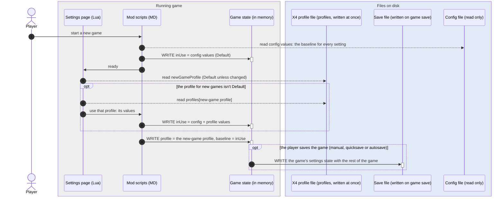

**Before**

```js
x4ProfileFile {
  profiles["Hard mode"]: { IntactOnEject: 0, IntactOnClaim: 0, CaptureWingFullChance: 0 }
  newGameProfile: "Hard mode"
}
gameState {
  (no game yet)
}
```

_This example uses Hard mode as the profile for new games._

**After step 3**

```js
gameState {
  ...
  inUse: { IntactOnEject: 1, IntactOnClaim: 1, CaptureWingFullChance: 1 }  // was not set
  ...
}
```

**After step 8**

```js
gameState {
  ...
  inUse.IntactOnEject: 0          // was 1
  inUse.IntactOnClaim: 0          // was 1
  inUse.CaptureWingFullChance: 0  // was 1
  ...
}
```

**After step 9**

```js
gameState {
  ...
  profile: "Hard mode"                                                        // was not set
  modified: false                                                             // was not set
  baseline: { IntactOnEject: 0, IntactOnClaim: 0, CaptureWingFullChance: 0 }  // was not set
  ...
}
```

**After step 10**

```js
saveFile {
  ...
  profile: "Hard mode"                                                     // was not set
  modified: false                                                          // was not set
  inUse: { IntactOnEject: 0, IntactOnClaim: 0, CaptureWingFullChance: 0 }  // was not set
  ...
}
```

**After**

```js
x4ProfileFile {
  profiles["Hard mode"]: { IntactOnEject: 0, IntactOnClaim: 0, CaptureWingFullChance: 0 }
  newGameProfile: "Hard mode"
}
gameState {
  inUse: { IntactOnEject: 0, IntactOnClaim: 0, CaptureWingFullChance: 0 }
  profile: "Hard mode"
  modified: false
  baseline: { IntactOnEject: 0, IntactOnClaim: 0, CaptureWingFullChance: 0 }
}
saveFile {
  profile: "Hard mode"
  modified: false
  inUse: { IntactOnEject: 0, IntactOnClaim: 0, CaptureWingFullChance: 0 }
}
```

## 2. Change a setting in a game that uses a profile

Game A uses the Hard mode profile, and the player turns one setting on. The dropdown stays on Hard mode, shown as "Hard mode *", but the game is now modified: it uses its own values and no longer follows Hard mode. That lasts for this play session: until the player saves the changes into Hard mode or picks a profile, or until the game is next loaded, when it switches to None (custom settings) (flow 4). Like everything else in the game, the change reaches disk with the next game save. The Hard mode profile and other games using it don't change.

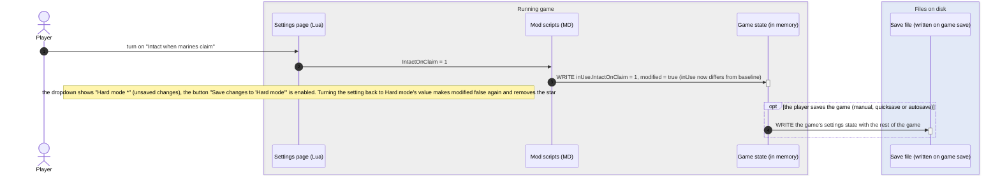

**Before**

```js
gameState {
  profile: "Hard mode"
  modified: false
  inUse: { IntactOnEject: 0, IntactOnClaim: 0, CaptureWingFullChance: 0 }
  baseline: { IntactOnEject: 0, IntactOnClaim: 0, CaptureWingFullChance: 0 }
}
saveFile {
  profile: "Hard mode"
  modified: false
  inUse: { IntactOnEject: 0, IntactOnClaim: 0, CaptureWingFullChance: 0 }
}
```

**After step 3**

```js
gameState {
  ...
  modified: true          // was false
  inUse.IntactOnClaim: 1  // was 0
  ...
}
```

**After step 4**

```js
saveFile {
  ...
  modified: true          // was false
  inUse.IntactOnClaim: 1  // was 0
  ...
}
```

**After**

```js
gameState {
  profile: "Hard mode"
  modified: true
  inUse: { IntactOnEject: 0, IntactOnClaim: 1, CaptureWingFullChance: 0 }
  baseline: { IntactOnEject: 0, IntactOnClaim: 0, CaptureWingFullChance: 0 }
}
saveFile {
  profile: "Hard mode"
  modified: true
  inUse: { IntactOnEject: 0, IntactOnClaim: 1, CaptureWingFullChance: 0 }
}
```

## 3. Save changes to the selected profile

Game C is on Hard mode and the player turned IntactOnEject on, so it's modified. The button targets whatever profile the dropdown shows: pressing "Save changes to 'Hard mode'" writes game C's values into Hard mode, and game C follows Hard mode again, which disables the button. Games on Hard mode without changes get the new values the next time they're loaded; modified games aren't affected.

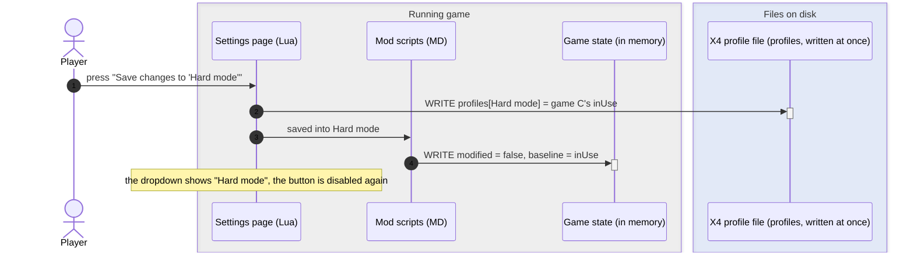

**Before**

```js
x4ProfileFile {
  profiles["Hard mode"]: { IntactOnEject: 0, IntactOnClaim: 0, CaptureWingFullChance: 0 }
}
gameState {
  profile: "Hard mode"
  modified: true
  inUse: { IntactOnEject: 1, IntactOnClaim: 0, CaptureWingFullChance: 0 }
  baseline: { IntactOnEject: 0, IntactOnClaim: 0, CaptureWingFullChance: 0 }
}
```

**After step 2**

```js
x4ProfileFile {
  ...
  profiles["Hard mode"].IntactOnEject: 1  // was 0
  ...
}
```

**After step 4**

```js
gameState {
  ...
  modified: false            // was true
  baseline.IntactOnEject: 1  // was 0
  ...
}
```

**After**

```js
x4ProfileFile {
  profiles["Hard mode"]: { IntactOnEject: 1, IntactOnClaim: 0, CaptureWingFullChance: 0 }
}
gameState {
  profile: "Hard mode"
  modified: false
  inUse: { IntactOnEject: 1, IntactOnClaim: 0, CaptureWingFullChance: 0 }
  baseline: { IntactOnEject: 1, IntactOnClaim: 0, CaptureWingFullChance: 0 }
}
```

## 4. Load a game

A game on a profile without changes gets that profile's current values, so it picks up changes saved from other games. A game saved while modified switches to None (custom settings) with its own saved values: the profile may have changed since, so "Hard mode *" would no longer mean anything. A game on None keeps its saved values, and so does a game whose profile is gone (deleted, or a save from another PC), which also switches to None. The example is game B, linked to Hard mode and last saved before flow 3 changed it.

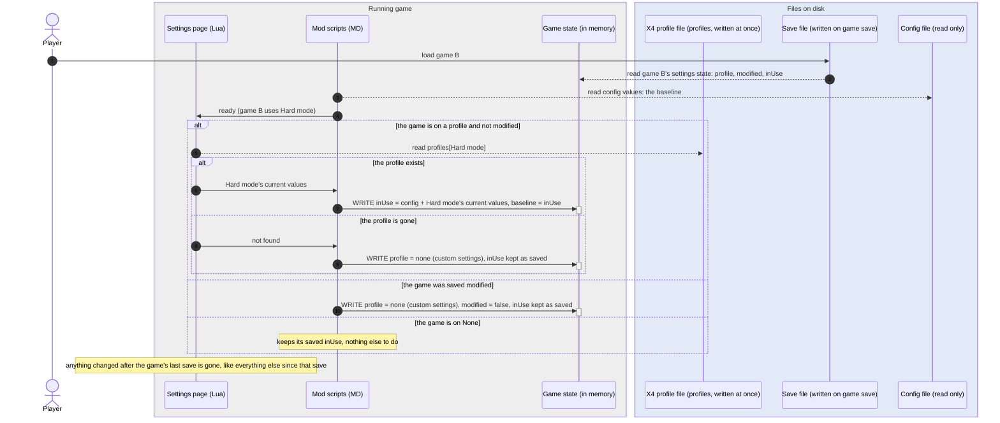

**Before**

```js
x4ProfileFile {
  profiles["Hard mode"]: { IntactOnEject: 1, IntactOnClaim: 0, CaptureWingFullChance: 0 }
}
saveFile {
  profile: "Hard mode"
  modified: false
  inUse: { IntactOnEject: 0, IntactOnClaim: 0, CaptureWingFullChance: 0 }
}
gameState {
  (not loaded yet)
}
```

**After step 2**

```js
gameState {
  ...
  profile: "Hard mode"                                                        // was not set
  modified: false                                                             // was not set
  inUse: { IntactOnEject: 0, IntactOnClaim: 0, CaptureWingFullChance: 0 }     // was not set
  baseline: { IntactOnEject: 0, IntactOnClaim: 0, CaptureWingFullChance: 0 }  // was not set
  ...
}
```

**After step 7**

```js
gameState {
  ...
  inUse.IntactOnEject: 1     // was 0
  baseline.IntactOnEject: 1  // was 0
  ...
}
```

_If Hard mode were gone (steps 8 and 9): profile null, inUse stays { IntactOnEject: 0, IntactOnClaim: 0, CaptureWingFullChance: 0 }. Game A from flow 2 was saved modified, so loading it switches it to None (custom settings) with its own inUse (step 10), whatever happened to Hard mode since._

**After**

```js
x4ProfileFile {
  profiles["Hard mode"]: { IntactOnEject: 1, IntactOnClaim: 0, CaptureWingFullChance: 0 }
}
saveFile {
  profile: "Hard mode"
  modified: false
  inUse: { IntactOnEject: 0, IntactOnClaim: 0, CaptureWingFullChance: 0 }
}
gameState {
  profile: "Hard mode"
  modified: false
  inUse: { IntactOnEject: 1, IntactOnClaim: 0, CaptureWingFullChance: 0 }
  baseline: { IntactOnEject: 1, IntactOnClaim: 0, CaptureWingFullChance: 0 }
}
```

## 5. Save the game

X4 writes the game state into the save file, and with it the game's settings state. None of our code runs: settings are saved because they're part of the game.

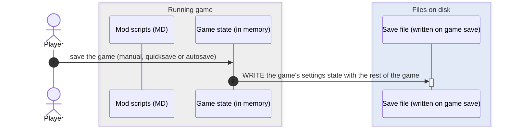

**Before**

```js
gameState {
  profile: "Hard mode"
  modified: true
  inUse: { IntactOnEject: 0, IntactOnClaim: 1, CaptureWingFullChance: 0 }
  baseline: { IntactOnEject: 0, IntactOnClaim: 0, CaptureWingFullChance: 0 }
}
saveFile {
  profile: "Hard mode"
  modified: false
  inUse: { IntactOnEject: 0, IntactOnClaim: 0, CaptureWingFullChance: 0 }
}
```

_Game A from flow 2: the save file still holds it as it was at the previous save._

**After step 2**

```js
saveFile {
  ...
  modified: true          // was false
  inUse.IntactOnClaim: 1  // was 0
  ...
}
```

**After**

```js
gameState {
  profile: "Hard mode"
  modified: true
  inUse: { IntactOnEject: 0, IntactOnClaim: 1, CaptureWingFullChance: 0 }
  baseline: { IntactOnEject: 0, IntactOnClaim: 0, CaptureWingFullChance: 0 }
}
saveFile {
  profile: "Hard mode"
  modified: true
  inUse: { IntactOnEject: 0, IntactOnClaim: 1, CaptureWingFullChance: 0 }
}
```

## 6. Save as new profile…

The only action that asks for a name. It creates a new profile from the game's current values and leaves the profile the game was on (Hard mode) exactly as it was: the game's unsaved changes go only into the new one. The game is then on the new profile, not modified.

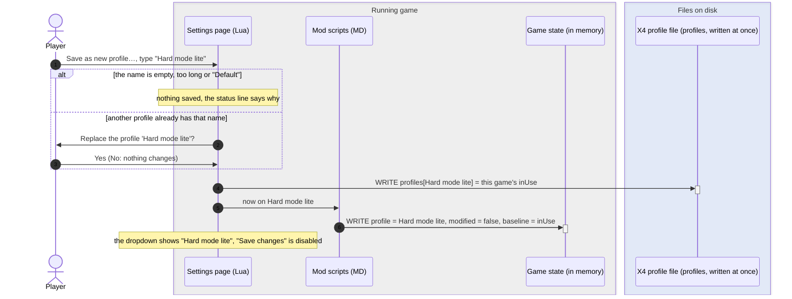

**Before**

```js
x4ProfileFile {
  profiles["Hard mode"]: { IntactOnEject: 0, IntactOnClaim: 0, CaptureWingFullChance: 0 }
}
gameState {
  profile: "Hard mode"
  modified: true
  inUse: { IntactOnEject: 0, IntactOnClaim: 1, CaptureWingFullChance: 0 }
  baseline: { IntactOnEject: 0, IntactOnClaim: 0, CaptureWingFullChance: 0 }
}
```

**After step 4**

```js
x4ProfileFile {
  profiles["Hard mode"]: { IntactOnEject: 0, IntactOnClaim: 0, CaptureWingFullChance: 0 }       // unchanged
  profiles["Hard mode lite"]: { IntactOnEject: 0, IntactOnClaim: 1, CaptureWingFullChance: 0 }  // new profile
}
```

**After step 6**

```js
gameState {
  ...
  profile: "Hard mode lite"  // was "Hard mode"
  modified: false            // was true
  baseline.IntactOnClaim: 1  // was 0
  ...
}
```

**After**

```js
x4ProfileFile {
  profiles["Hard mode"]: { IntactOnEject: 0, IntactOnClaim: 0, CaptureWingFullChance: 0 }
  profiles["Hard mode lite"]: { IntactOnEject: 0, IntactOnClaim: 1, CaptureWingFullChance: 0 }
}
gameState {
  profile: "Hard mode lite"
  modified: false
  inUse: { IntactOnEject: 0, IntactOnClaim: 1, CaptureWingFullChance: 0 }
  baseline: { IntactOnEject: 0, IntactOnClaim: 1, CaptureWingFullChance: 0 }
}
```

## 7. Switch to another profile

Choosing a profile in the dropdown asks first when the game is modified, so its own values are never thrown away without a question. The game's values are rebuilt from the config plus the new profile.

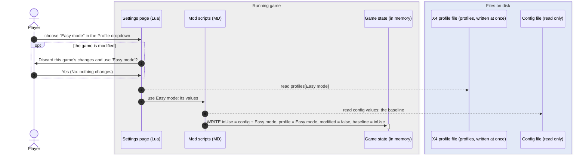

**Before**

```js
x4ProfileFile {
  profiles["Hard mode"]: { IntactOnEject: 0, IntactOnClaim: 0, CaptureWingFullChance: 0 }
  profiles["Easy mode"]: { IntactOnEject: 1, IntactOnClaim: 1, CaptureWingFullChance: 0 }
}
gameState {
  profile: "Hard mode"
  modified: true
  inUse: { IntactOnEject: 0, IntactOnClaim: 1, CaptureWingFullChance: 0 }
  baseline: { IntactOnEject: 0, IntactOnClaim: 0, CaptureWingFullChance: 0 }
}
```

**After step 7**

```js
gameState {
  ...
  profile: "Easy mode"       // was "Hard mode"
  modified: false            // was true
  inUse.IntactOnEject: 1     // was 0
  baseline.IntactOnEject: 1  // was 0
  baseline.IntactOnClaim: 1  // was 0
  ...
}
```

**After**

```js
x4ProfileFile {
  profiles["Hard mode"]: { IntactOnEject: 0, IntactOnClaim: 0, CaptureWingFullChance: 0 }
  profiles["Easy mode"]: { IntactOnEject: 1, IntactOnClaim: 1, CaptureWingFullChance: 0 }
}
gameState {
  profile: "Easy mode"
  modified: false
  inUse: { IntactOnEject: 1, IntactOnClaim: 1, CaptureWingFullChance: 0 }
  baseline: { IntactOnEject: 1, IntactOnClaim: 1, CaptureWingFullChance: 0 }
}
```

## 8. Switch to Default

The same as switching to any profile, without profile values: the game goes back to the config file's values and follows the config from then on.

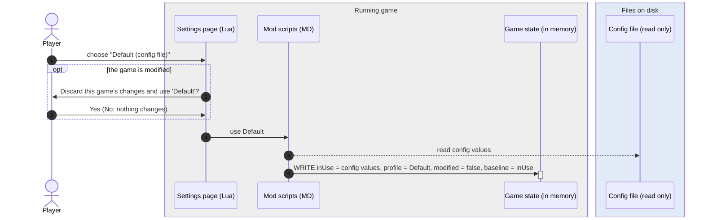

**Before**

```js
gameState {
  profile: "Hard mode"
  modified: true
  inUse: { IntactOnEject: 0, IntactOnClaim: 1, CaptureWingFullChance: 0 }
  baseline: { IntactOnEject: 0, IntactOnClaim: 0, CaptureWingFullChance: 0 }
}
```

**After step 6**

```js
gameState {
  ...
  profile: "Default"                                                          // was "Hard mode"
  modified: false                                                             // was true
  inUse.IntactOnEject: 1                                                      // was 0
  inUse.CaptureWingFullChance: 1                                              // was 0
  baseline: { IntactOnEject: 1, IntactOnClaim: 1, CaptureWingFullChance: 1 }  // was { IntactOnEject: 0, IntactOnClaim: 0, CaptureWingFullChance: 0 }
  ...
}
```

**After**

```js
gameState {
  profile: "Default"
  modified: false
  inUse: { IntactOnEject: 1, IntactOnClaim: 1, CaptureWingFullChance: 1 }
  baseline: { IntactOnEject: 1, IntactOnClaim: 1, CaptureWingFullChance: 1 }
}
```

## 9. Change the profile for new games

One value in the X4 profile file. Existing games keep whatever they use.

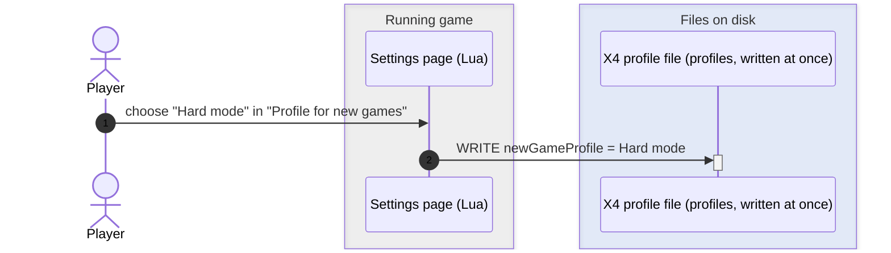

**Before**

```js
x4ProfileFile {
  newGameProfile: "Default"
}
```

**After step 2**

```js
x4ProfileFile {
  ...
  newGameProfile: "Hard mode"  // was "Default"
  ...
}
```

**After**

```js
x4ProfileFile {
  newGameProfile: "Hard mode"
}
```

## 10. Delete a profile

Nothing changes in any game that used it: each switches to None (custom settings) with the values it had. The current game switches at once; other games find the profile gone on their next load (flow 4).

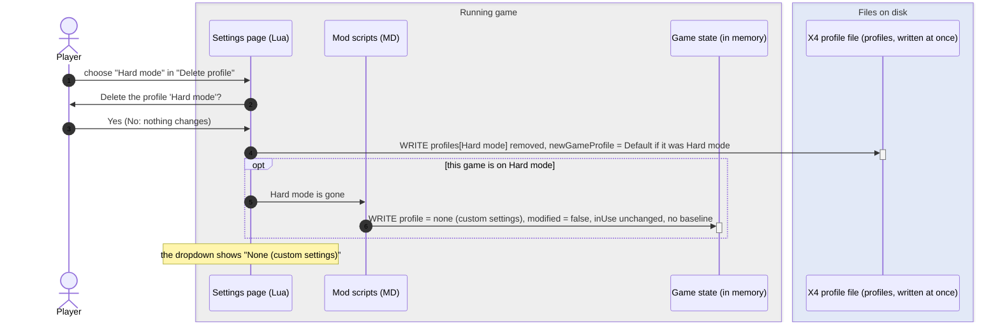

**Before**

```js
x4ProfileFile {
  profiles["Hard mode"]: { IntactOnEject: 0, IntactOnClaim: 0, CaptureWingFullChance: 0 }
  profiles["Easy mode"]: { IntactOnEject: 1, IntactOnClaim: 1, CaptureWingFullChance: 0 }
  newGameProfile: "Hard mode"
}
gameState {
  profile: "Hard mode"
  modified: false
  inUse: { IntactOnEject: 0, IntactOnClaim: 0, CaptureWingFullChance: 0 }
  baseline: { IntactOnEject: 0, IntactOnClaim: 0, CaptureWingFullChance: 0 }
}
```

**After step 4**

```js
x4ProfileFile {
  // profiles["Hard mode"] deleted (was { IntactOnEject: 0, IntactOnClaim: 0, CaptureWingFullChance: 0 })
  profiles["Easy mode"]: { IntactOnEject: 1, IntactOnClaim: 1, CaptureWingFullChance: 0 }  // unchanged
  newGameProfile: "Default"                                                                // was "Hard mode"
}
```

**After step 6**

```js
gameState {
  ...
  profile: null  // was "Hard mode"
  // baseline removed (was { IntactOnEject: 0, IntactOnClaim: 0, CaptureWingFullChance: 0 }): a game on None has none
  ...
}
```

**After**

```js
x4ProfileFile {
  profiles["Easy mode"]: { IntactOnEject: 1, IntactOnClaim: 1, CaptureWingFullChance: 0 }
  newGameProfile: "Default"
}
gameState {
  profile: null
  modified: false
  inUse: { IntactOnEject: 0, IntactOnClaim: 0, CaptureWingFullChance: 0 }  // the same values Hard mode had when it was deleted
}
```

## 11. A profile with an unknown or invalid setting

A setting the mod no longer has, or a value it can't take, is ignored and logged, so that setting keeps its config value. Saving changes to the profile drops the leftover.

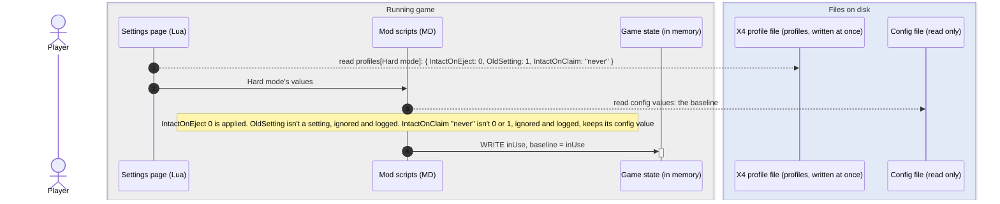

**Before**

```js
x4ProfileFile {
  profiles["Hard mode"]: { IntactOnEject: 0, OldSetting: 1, IntactOnClaim: "never" }
}
gameState {
  profile: "Hard mode"
  modified: false
  inUse: { IntactOnEject: 1, IntactOnClaim: 1, CaptureWingFullChance: 1 }
  baseline: { IntactOnEject: 1, IntactOnClaim: 1, CaptureWingFullChance: 1 }
}
```

**After step 4**

```js
gameState {
  ...
  inUse.IntactOnEject: 0     // was 1
  baseline.IntactOnEject: 0  // was 1
  ...
}
```

_IntactOnEject: 0 comes from the profile. IntactOnClaim and CaptureWingFullChance keep their config values: "never" isn't a valid IntactOnClaim (only 0 or 1), and the profile has no CaptureWingFullChance. OldSetting is ignored._

**After**

```js
x4ProfileFile {
  profiles["Hard mode"]: { IntactOnEject: 0, OldSetting: 1, IntactOnClaim: "never" }
}
gameState {
  profile: "Hard mode"
  modified: false
  inUse: { IntactOnEject: 0, IntactOnClaim: 1, CaptureWingFullChance: 1 }
  baseline: { IntactOnEject: 0, IntactOnClaim: 1, CaptureWingFullChance: 1 }
}
```

## Decisions not drawn above

- **A game's profile is what the Profile dropdown shows:** Default, a saved profile, or null for "None (custom settings)". Changing a setting so the game's values differ from what the profile gave it (`baseline`) sets `modified`; turning it back clears it (Erik, 2026-10-26). the dropdown stays on the profile but reads "Hard mode *", the usual mark for unsaved changes, and the game keeps its own `inUse` and no longer follows the profile. Picking a profile again, or saving into it, clears `modified` (Erik, 2026-10-24).
- **"Save changes to 'Hard mode'"** targets whatever profile the dropdown shows. It's enabled only while the game is modified and that profile is a saved one (not Default, not None). It writes the game's values into the profile, clears `modified`, and disables itself. The profile's name is on the button.
- **Choosing a profile always reloads it and clears `modified`:** picking any profile in the dropdown (including Default, or the same profile again) rebuilds `inUse` from the config plus that profile and sets `modified` to false. So does saving into a profile ("Save changes to …" or "Save as new profile…"). If the game is modified, the page asks first (Erik, 2026-10-24).
- **`modified` lasts only for the play session:** a game loaded with `modified: true` switches to None (custom settings), clears `modified` and keeps its `inUse`, since the profile may have changed since it was saved. Until then, every time the settings page is opened it shows "Hard mode *" with "Save changes to 'Hard mode'" enabled, and saving the game (autosaves included) doesn't change that. Loading any save counts as the next load, even without quitting X4. After that, its values reach a profile only through "Save as new profile…" (Erik, 2026-10-24).
- **None (custom settings)** means the game's settings aren't linked to any profile: it uses its own `inUse` and follows nothing. A game gets there when it was saved with changes (shown as None from its next load) or when its profile no longer exists on load (deleted, or a save from another PC) (Erik, 2026-10-24).
- Settings changed in a game are part of that game, saved with it like everything else: quitting without saving loses them along with the rest of the progress since the last save (Erik, 2026-10-23). No game IDs and no per-game entries in the X4 profile file. Only profiles are shared live across games.
- No separate backup of the profile's values: the game's `inUse` is saved with it, and a game whose profile is missing on load (deleted, another PC, lost X4 profile file) switches to None with it (Erik, 2026-10-23).
- The config file always applies first: the baseline for every setting, including tuning values and settings a profile lacks (e.g. a setting added after the profile was saved).
- Unknown or invalid settings in a profile are ignored and logged, so they keep their config value. Profiles are only ever written when the player saves into one ("Save changes to …", "Save as new profile…"), never on load: a missing setting keeps following the config default, and leftovers are dropped at the next manual save (Erik, 2026-10-24).
- Setting names are never reused: a setting whose meaning changes gets a new name.
- Test isolation for `make game-test`, for tests that create profiles or change the profile for new games: profiles created in the `apirateslife_test` game start are marked `test = true` (written only, never read during play). BeforeAll deletes everything marked `test` (leftovers from a crashed run) and copies the X4 profile file's settings table; AfterEach removes what the test created and restores "Profile for new games"; AfterAll restores the copy.
